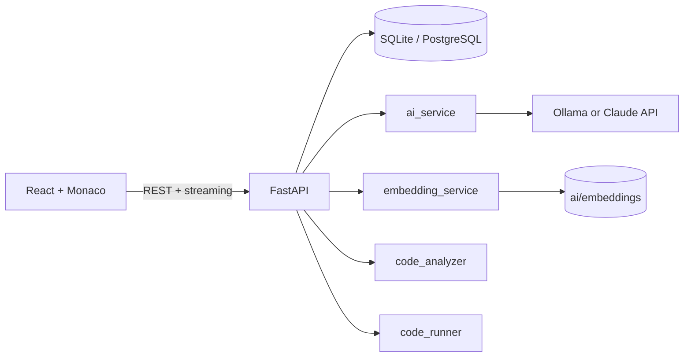

# AI Coding Assistant

A web-based coding assistant: write code in a Monaco editor, run it, and get AI help to explain, debug, refactor, and generate code. The chat can search your whole project (RAG), and it runs on a free local model through Ollama.

## Features

- Account system with JWT login and per-user projects and files
- Monaco code editor (Python and JavaScript) with saved files
- Run code with a timeout and see output or errors
- **Run + Debug**: static analysis and the real error are sent to the AI, which suggests a fix you can apply with one click
- AI tools: explain, debug, refactor, and generate code
- Streaming chat with conversation memory
- **Project-aware answers**: your files are split into chunks, embedded, and searched, so the assistant can answer questions about code that isn't open in the editor
- Rate limiting and input size limits

## Tech stack

| Layer | Technology |
|---|---|
| Frontend | React (Vite), React Router, Monaco Editor, react-markdown |
| Backend | Python, FastAPI, SQLAlchemy |
| Database | SQLite (PostgreSQL-ready) |
| AI | Ollama (`qwen2.5-coder`), or the Claude API |
| Embeddings | Ollama `nomic-embed-text`, cosine similarity with NumPy |

## Architecture



**How the AI part works**

1. `prompt_manager` loads a system prompt from `ai/prompts/` for each feature (explain, debug, refactor, generate, chat).
2. For debugging, `code_analyzer` (AST + pyflakes) and `code_runner` collect real errors, which are added to the prompt.
3. For chat, `embedding_service` splits project files into overlapping chunks, embeds only the files that changed, and retrieves the most similar chunks for the question.
4. `ai_service` sends the final prompt to the configured provider and streams the reply back.

## Project structure

```
AI-Coding-Assistant/
├── frontend/            React app (components, pages, api.js)
├── backend/
│   ├── main.py
│   ├── routes/          auth, ai, code, projects
│   ├── services/        ai_service, prompt_manager, embedding_service,
│   │                    code_analyzer, code_runner, rate_limiter
│   ├── database/        models.py, database.py
│   └── tests/           pytest suite
├── ai/
│   ├── prompts/         system prompt for each AI feature
│   └── embeddings/      generated project indexes (not committed)
├── database/schema.sql  reference SQL schema (the app creates tables itself)
└── README.md
```

## Setup

**Prerequisites:** Python 3.11+, Node.js, [Ollama](https://ollama.com)

**1. AI models**

```bash
ollama pull qwen2.5-coder:1.5b
ollama pull nomic-embed-text
```

Use `qwen2.5-coder:7b` if you have 16 GB of RAM or more.

**2. Backend**

```bash
cd backend
python -m venv venv
venv\Scripts\Activate.ps1        # Windows PowerShell
# source venv/bin/activate       # macOS / Linux
pip install -r requirements.txt
cp .env.example .env             # Windows: copy .env.example .env
```

Edit `.env` and set `SECRET_KEY` (generate one with `python -c "import secrets; print(secrets.token_hex(32))"`). Then:

```bash
uvicorn main:app --reload
```

API docs: http://localhost:8000/docs

**3. Frontend**

```bash
cd frontend
npm install
npm run dev
```

Open http://localhost:5173

## Configuration (`backend/.env`)

| Variable | Purpose |
|---|---|
| `SECRET_KEY` | Signs login tokens (required) |
| `DATABASE_URL` | Database connection (default: SQLite file) |
| `CORS_ORIGINS` | Allowed frontend origins, comma-separated |
| `AI_PROVIDER` | `ollama` or `anthropic` |
| `OLLAMA_MODEL`, `EMBED_MODEL` | Local chat and embedding models |
| `ANTHROPIC_API_KEY`, `ANTHROPIC_MODEL` | Only for `AI_PROVIDER=anthropic` |
| `ENABLE_CODE_RUNNER` | Set to `false` to disable code execution |
| `RATE_LIMIT_AI`, `RATE_LIMIT_CODE` | Requests per user per minute |

## Tests

```bash
cd backend
pip install pytest
pytest
```

Tests use a temporary database and mocked AI responses, so they need no Ollama.

## Security notes and limitations

- **The code runner is not a sandbox.** It uses a timeout, a temporary directory, stripped environment variables, and output limits, but code can still read local files and use the network. Run it only on your own machine. Before exposing it publicly, run code inside Docker (no network, CPU and memory limits), or set `ENABLE_CODE_RUNNER=false`.
- Passwords are hashed with bcrypt, and every project route checks ownership.
- The login token is stored in browser `localStorage`, which is simple but exposed if the site has an XSS bug.
- The rate limiter is in memory (one process). Multiple workers need a shared store such as Redis.
- Small local models make mistakes. Review AI-suggested code before using it.
- Embeddings need Ollama. Without it, chat still works but without project search.

## Roadmap

- Docker-based sandbox for the code runner
- More languages
- Diff view for AI suggestions
- File tree and multi-file runs
